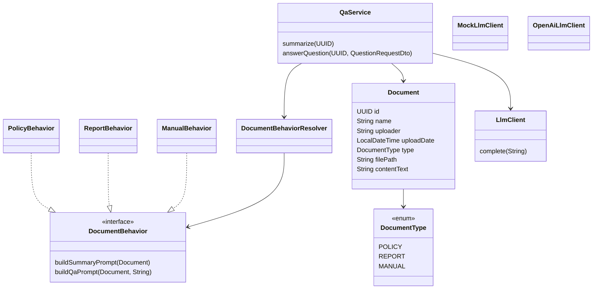
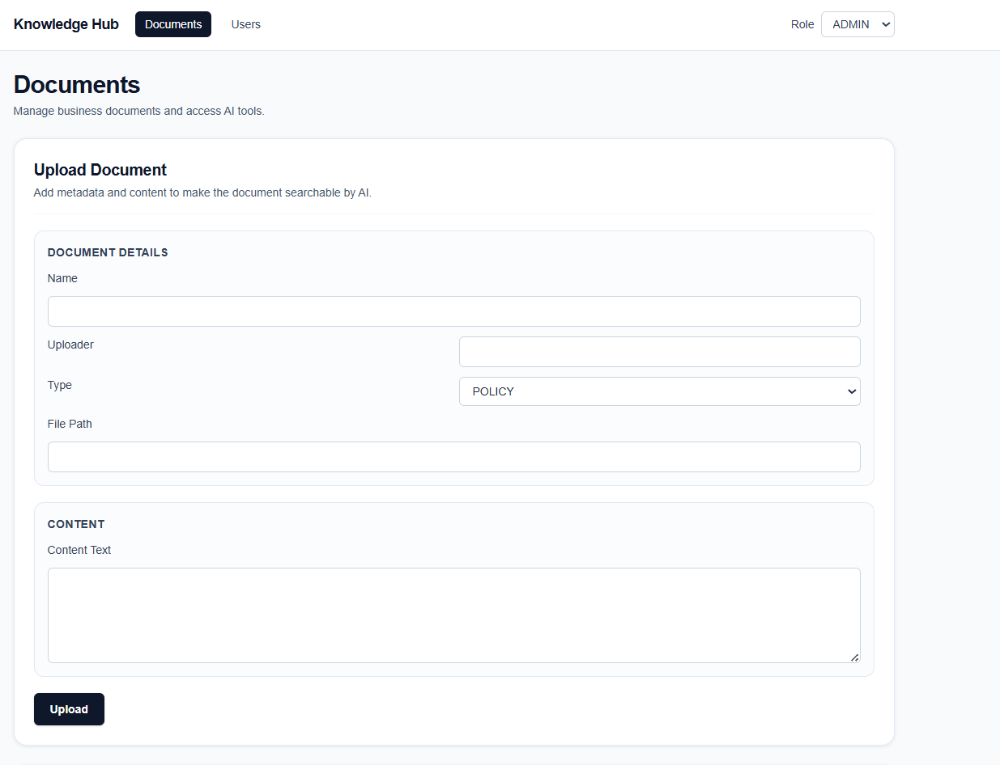
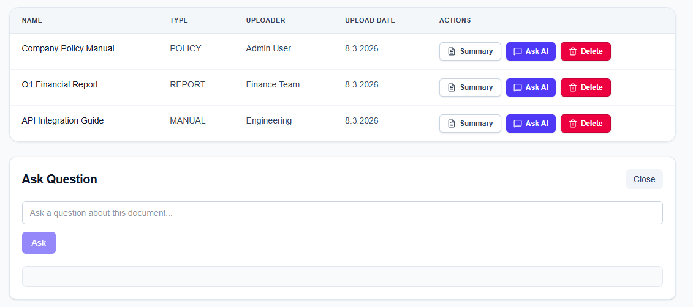
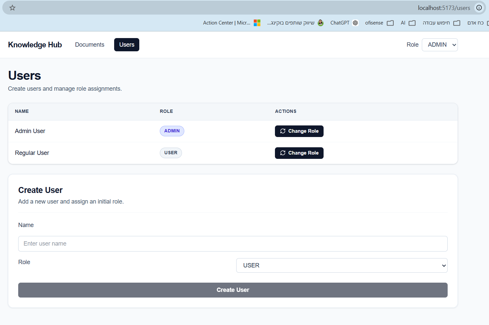

# AI-Powered Knowledge Hub

AI-Powered Knowledge Hub is a modular full-stack system for managing organizational documents and enabling AI-powered summarization and Q&A over document content.

The system demonstrates clean backend architecture using Spring Boot, OOP design principles, and an abstraction layer for integrating Large Language Models (LLMs). The application allows organizations to store documents, generate summaries, and ask contextual questions about document content.

---

## System Overview

The system enables users to:

* Upload and manage business documents
* View AI-generated summaries
* Ask questions about documents
* Manage users and roles
* Interact with AI through a structured backend service layer

Supported document types:

* **POLICY** – organizational policies and rules
* **REPORT** – analytical or statistical reports
* **MANUAL** – operational guides and instructions

Core capabilities:

* Document metadata management (CRUD)
* AI-powered summarization
* AI-powered Q&A
* Simplified RBAC role simulation (`ADMIN` / `USER`)
* Pluggable LLM provider (mock or OpenAI)

---

# High-Level Architecture

The system follows a simple modular architecture.

Request flow:

Frontend (React + Vite)
→ REST Controllers (Spring Boot)
→ Service Layer (business orchestration)
→ Document Behavior Strategy
→ LLM Client
→ Response returned to UI

This structure keeps responsibilities clearly separated and allows components to evolve independently.

---

# Backend Architecture

The backend is implemented as a **modular monolith** using:

* **Package-by-feature organization**
* **Layered architecture**

Main backend modules:

* `documents` – document management and persistence
* `qa` – Q&A and summarization logic
* `llm` – LLM provider abstraction
* `users` – user management
* `config` – application configuration and interceptors
* `common` – shared utilities and error handling

Layer responsibilities:

**Controllers**

* Expose REST endpoints
* Convert HTTP requests to service calls
* Return DTO responses

**Services**

* Orchestrate business logic
* Load domain entities
* Resolve document behavior
* Call LLM providers

**Repositories**

* Data persistence
* JPA repository for documents
* In-memory repository for users

**LLM Layer**

* Abstraction over LLM providers

**Config Layer**

* Registers interceptors
* Configures LLM providers

---

# UML Overview



---

# OOP Design

## Strategy Pattern

Different document types require different prompt-building logic.
This behavior is implemented using the **Strategy Pattern**.

Strategy interface:

```
DocumentBehavior
```

Implementations:

* `PolicyBehavior`
* `ReportBehavior`
* `ManualBehavior`

A resolver (`DocumentBehaviorResolverImpl`) maps each `DocumentType` to its corresponding strategy.

This allows document behavior to change without modifying the service layer.

---

## Open / Closed Principle

The system is designed so new document types can be added without modifying existing services.

To introduce a new type:

1. Extend `DocumentType`
2. Implement a new `DocumentBehavior`
3. Register the behavior in the resolver

No changes are required in `QaService`.

---

## Separation of Concerns

Responsibilities are clearly separated:

Controllers
→ HTTP interaction

Services
→ business orchestration

Repositories
→ persistence

Behavior Strategies
→ prompt generation

LLM Client
→ AI integration

Cross-cutting components:

* `RoleInterceptor`
* `GlobalExceptionHandler`

---

## Dependency Inversion

The service layer depends on the abstraction:

```
LlmClient
```

Instead of a concrete provider.

This allows switching between AI providers without modifying business logic.

---

# LLM Integration

The system integrates with LLM providers through a dedicated abstraction.

Interface:

```
LlmClient.complete(prompt)
```

Implementations:

**MockLlmClient**

* Used for local testing
* Returns deterministic responses
* No API key required

**OpenAiLlmClient**

* Integrates with the OpenAI Chat API
* Uses Spring WebClient
* Model configurable via application properties

Provider selection:

```
knowledgehub.llm.provider = mock | openai
```

This allows the application to run locally without external dependencies.

---

# Security Model

The system uses a simplified **role-based access control simulation**.

Roles:

* ADMIN
* USER

The role is passed via query parameter:

```
?role=ADMIN
?role=USER
```

Authorization is implemented using:

* `@RequiresRole` annotation
* `RoleInterceptor`

The interceptor:

1. Reads the role from the request
2. Validates the role
3. Checks if the controller endpoint allows that role
4. Blocks unauthorized requests

Authorization rules:

| Endpoint        | ADMIN | USER |
| --------------- | ----- | ---- |
| Create Document | ✔     | ❌    |
| Delete Document | ✔     | ❌    |
| List Documents  | ✔     | ❌    |
| Get Document    | ✔     | ❌    |
| Summary         | ✔     | ✔    |
| Ask Question    | ✔     | ✔    |

Authorization is handled outside the service layer.

Error handling:

* 400 Bad Request — missing or invalid role
* 403 Forbidden — role not permitted for endpoint

---

# Development Methodology

The project was developed using **spec-driven development** with AI-assisted implementation.

## Specification First

Architecture and feature behavior were defined before implementation.

Specification documents:

* `ARCHITECTURE.md`
* `API_CONTRACT.md`
* `DOCUMENTS_SPEC.md`
* `QA_SPEC.md`
* `USERS_SPEC.md`
* `SECURITY_SPEC.md`
* `LLM_SPEC.md`
* `PLAN.md`

These files define system behavior and served as the primary source of truth during implementation.

---

## AI-Assisted Development

GitHub Copilot was used to accelerate development by generating:

* controller skeletons
* DTO classes
* service scaffolding
* repetitive boilerplate

---

## Manual Engineering Decisions

Key engineering decisions were made manually, including:

* backend architecture
* module boundaries
* RBAC interceptor approach
* document behavior strategy pattern
* LLM abstraction layer
* API design

---

# Running the System

Prerequisites:

* Java 17
* Node.js

---

## Start Backend

From the project root:

```
./mvnw spring-boot:run
```

Windows PowerShell:

```
.\mvnw spring-boot:run
```

Backend URL:

```
http://localhost:8080
```

---

## Start Frontend

```
cd knowledgehub-frontend
npm install
npm run dev
```

Frontend URL:

```
http://localhost:5173
```

---

# Frontend (React)

The frontend is implemented using:

* React
* TypeScript
* Vite
* Axios
* React Router

Main screens:

**Documents Page**

* Upload document (ADMIN)
* List documents
* Generate summary
* Ask AI questions
* Delete document (ADMIN)

**Users Page**

* List users
* Create users
* Change roles

---

# Role Simulation in UI

Authentication is intentionally omitted.

A role selector exists in the UI:

```
ADMIN | USER
```

The selected role is automatically appended to API requests via an Axios interceptor.

Note: Authorization is still enforced on the backend by RoleInterceptor.
The UI role selector only simulates the role used in API requests.

---

# Example Workflow

1. Start backend
2. Start frontend
3. Open `http://localhost:5173`
4. Upload a document as ADMIN
5. Generate summary
6. Ask questions
7. Switch role to USER and observe permissions

---

# API Endpoints

## Documents

```
POST /documents?role=ADMIN
GET /documents?role=ADMIN
GET /documents/{id}?role=ADMIN
DELETE /documents/{id}?role=ADMIN
```

## AI

```
GET /documents/{id}/summary?role=ADMIN|USER
POST /documents/{id}/questions?role=ADMIN|USER
```

## Users

```
GET /users
POST /users
PUT /users/{id}/role?role=ADMIN|USER
```

---

# Screenshots






---

# API Documentation

Swagger UI:

```
http://localhost:8080/swagger-ui/index.html
```

OpenAPI spec:

```
http://localhost:8080/v3/api-docs
```

---

# AI Usage Disclosure

AI tooling (GitHub Copilot) was used to assist with:

* boilerplate generation
* DTO scaffolding
* endpoint templates
* formatting and refactoring

The following aspects were designed manually:

* system architecture
* module boundaries
* RBAC design
* strategy pattern for document behavior
* LLM abstraction layer
* API structure
* service orchestration

The system design and final implementation decisions were made manually.
